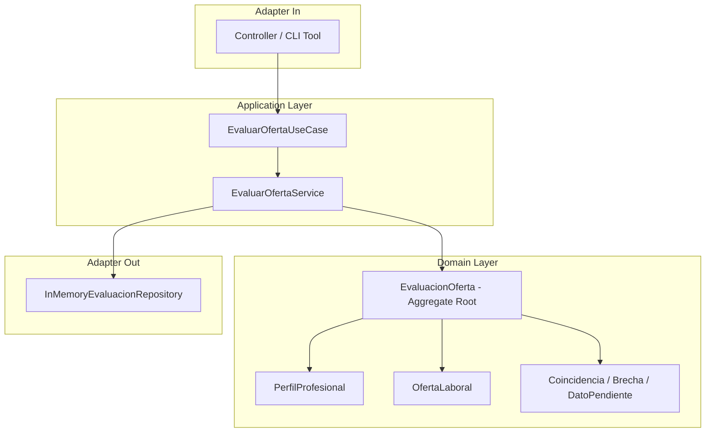

# Requirements

### Overview & Goals
El caso de uso **UC-002 — Evaluar oferta de empleo** tiene como objetivo analizar la compatibilidad entre una oferta laboral (`OfertaLaboral`) y el perfil profesional de un candidato (`PerfilProfesional`), generando un reporte determinista y explicable compuesto por:
1. **Coincidencias (Matches):** aspectos donde el perfil cumple o supera los requisitos de la oferta (tecnologías dominadas, modalidad compatible, ubicación admitida, rango salarial).
2. **Brechas (Gaps):** requisitos exigidos por la oferta que el perfil no satisface (tecnologías faltantes, incompatibilidad de modalidad o ubicación).
3. **Datos Pendientes (Questions / Pending):** información ambigua o ausente en la oferta o en el perfil que requiere clarificación (ej. salario no publicado, años de experiencia no especificados).

### Scope
- **In Scope:**
  - Especificación formal en `docs/casos-de-uso/UC-002-evaluar-oferta.md` respetando `docs/casos-de-uso/PLANTILLA.md`.
  - Actualización de `docs/README.md`.
  - Definición del modelo de dominio táctico DDD: `PerfilProfesional`, `EvaluacionOferta` (Aggregate Root), `Coincidencia`, `Brecha`, `DatoPendiente` y `EstadoEvaluacion`.
  - Reglas deterministas de evaluación basadas en hechos y evidencia (sin inferencias arbitrarias ni porcentajes inventados).
  - Puertos de entrada/salida y servicio de aplicación en memoria.
- **Out of Scope (Hitos posteriores):**
  - Inferencia y evaluación mediante modelos LLM (Hito M5).
  - Persistencia relacional en PostgreSQL (Hito M4).
  - Postulación automática a empleos.

### User Stories
- **Como** candidato en búsqueda de empleo,
- **Quiero** evaluar una oferta laboral contra mi perfil profesional,
- **Para** conocer de manera transparente mis fortalezas, brechas técnicas y preguntas clave antes de decidir si postularme.

### Functional Requirements
- **FR-01 (Entrada de evaluación):** Debe recibir una oferta laboral (identificador existente o datos directos) y un perfil profesional explícito.
- **FR-02 (Evaluación de tecnologías):** Identificar tecnologías comunes como *Coincidencias* y tecnologías requeridas por la oferta no presentes en el perfil como *Brechas*.
- **FR-03 (Evaluación de modalidad y ubicación):** Comparar la modalidad (`REMOTE`, `HYBRID`, `ONSITE`) y la ubicación; registrar brechas si hay incompatibilidad insalvable.
- **FR-04 (Evaluación salarial):** Si la oferta publica salario y el perfil define expectativa salarial, contrastar si la expectativa está cubierta; si alguno de los dos no publica salario, registrarlo como *Dato Pendiente* (nunca inventar ni asumir cero).
- **FR-05 (Evidencia explicable):** Cada coincidencia, brecha o dato pendiente debe contener una descripción clara y el hecho o criterio en el que se fundamenta.
- **FR-06 (Estado de evaluación):** Clasificar el resultado global de la evaluación (`COMPATIBLE`, `COMPATIBLE_CON_BRECHAS`, `NO_COMPATIBLE`).

### Non-Functional Requirements
- **Determinismo y Pureza:** La capa de dominio debe evaluar sin dependencias de Spring, HTTP, librerías de terceros ni llamadas a APIs de IA.
- **Inmutabilidad:** Todos los Value Objects y modelos de evaluación deben ser inmutables.
- **Compatibilidad:** Ejecución limpia sobre Java 27 y Maven Wrapper.

# Technical Design

### Current Implementation
Actualmente el proyecto cuenta con el caso de uso **UC-001** implementado bajo arquitectura hexagonal:
- Modelo de dominio: `OfertaLaboral`, `CriteriosBusqueda`, `Salario`, `ModalidadTrabajo`.
- Puerto de entrada: `BuscarOfertasUseCase`.
- Adaptador de salida simulado: `FuenteOfertasSimuladaAdapter`.
- Servicio: `BuscarOfertasService`.
- Excepciones y DTOs en `opportunities/`.

### Key Decisions
1. **Bounded Context & Modularidad:**
   - La evaluación puede convivir dentro del módulo de oportunidades (`com.gustavo.jobagent.opportunities` o subpaquete `evaluation`), manteniendo `OfertaLaboral` y `PerfilProfesional` con identidad propia, mientras que `EvaluacionOferta` actúa como Aggregate Root.
2. **Evaluación Determinista vs IA:**
   - El dominio implementa la lógica de contraste de hechos (conjuntos de tecnologías, modalidades, salarios conocidos). En M5 se añadirá el puerto para enriquecimiento con LLM, pero las reglas base permanecerán sólidas y reproducibles sin IA.
3. **Ausencia de datos:**
   - Si un campo no está presente (ej. salario en la oferta o años en el perfil), genera un `DatoPendiente` en lugar de fallar o penalizar falsamente.

### Proposed Changes & Domain Model

#### 1. Nuevos Modelos de Dominio (`opportunities/domain`):
- `PerfilProfesional`:
  - `id`: identificador del perfil.
  - `nombre`: nombre del candidato.
  - `tituloPrincipal`: cargo o especialidad.
  - `tecnologias`: `Set<String>` (normalizadas en minúsculas/trim).
  - `modalidadesAceptadas`: `Set<ModalidadTrabajo>`.
  - `ubicacion`: `String`.
  - `expectativaSalarial`: `Salario` (opcional).
- `TipoAspecto`: `TECNOLOGIA`, `MODALIDAD`, `UBICACION`, `SALARIO`, `EXPERIENCIA`.
- `Coincidencia` (Value Object):
  - `aspecto`: `TipoAspecto`.
  - `detalle`: `String`.
  - `evidencia`: `String`.
- `Brecha` (Value Object):
  - `aspecto`: `TipoAspecto`.
  - `detalle`: `String`.
  - `esBloqueante`: `boolean`.
- `DatoPendiente` (Value Object):
  - `aspecto`: `TipoAspecto`.
  - `pregunta`: `String`.
- `EstadoEvaluacion`: `COMPATIBLE`, `COMPATIBLE_CON_BRECHAS`, `NO_COMPATIBLE`.
- `EvaluacionOferta` (Aggregate Root):
  - `id`: UUID / String.
  - `idOferta`: String.
  - `idPerfil`: String.
  - `estado`: `EstadoEvaluacion`.
  - `coincidencias`: `List<Coincidencia>`.
  - `brechas`: `List<Brecha>`.
  - `datosPendientes`: `List<DatoPendiente>`.
  - `fechaEvaluacion`: `Instant`.
  - Método de fábrica: `static EvaluacionOferta evaluar(OfertaLaboral oferta, PerfilProfesional perfil)`.

#### 2. Puertos y Aplicación (`opportunities/application`):
- Puerto de entrada: `EvaluarOfertaUseCase` con método `EvaluacionOferta evaluar(EvaluarOfertaCommand comando)`.
- Puerto de salida: `EvaluacionOfertaRepository` (`guardar(EvaluacionOferta)`, `buscarPorId(String)`).
- Servicio: `EvaluarOfertaService`.

### Architecture Diagram



### File Structure
```text
docs/
├── README.md                                 # Actualizado con enlace a UC-002
└── casos-de-uso/
    └── UC-002-evaluar-oferta.md              # Nueva especificación formal

src/main/java/com/gustavo/jobagent/opportunities/
├── domain/
│   ├── PerfilProfesional.java
│   ├── EvaluacionOferta.java
│   ├── Coincidencia.java
│   ├── Brecha.java
│   ├── DatoPendiente.java
│   ├── TipoAspecto.java
│   └── EstadoEvaluacion.java
├── application/
│   ├── port/in/
│   │   ├── EvaluarOfertaUseCase.java
│   │   └── EvaluarOfertaCommand.java
│   ├── port/out/
│   │   └── EvaluacionOfertaRepository.java
│   └── service/
│       └── EvaluarOfertaService.java
└── adapter/out/persistence/
    └── InMemoryEvaluacionOfertaRepository.java
```

# Testing

### Validation Approach
La verificación de UC-002 seguirá la estrategia de testing piramidal de DDD y Clean Architecture:
1. **Pruebas de Dominio Puras (Unitarias):**
   - Validar las reglas de evaluación sin ningún contexto de Spring ni frameworks.
   - Probar escenarios de compatibilidad total, compatibilidad parcial con brechas, y no compatibilidad por requisitos bloqueantes.
2. **Pruebas de Servicio de Aplicación (Unitarias con Fakes/Mocks):**
   - Verificar la orquestación del caso de uso `EvaluarOfertaService` y la interacción con el repositorio.
3. **Pruebas de Integración y Regresión:**
   - Comprobar que toda la suite de Maven (`./mvnw clean test`) compile y ejecute limpiamente en Java 27.

### Key Scenarios
- **Escenario 1 (Match pleno):** Perfil con Java, Spring Boot y Kafka evaluado contra oferta remota de Java/Kafka en Colombia. Resultado: `COMPATIBLE` con coincidencias en tecnologías y modalidad, sin brechas bloqueantes.
- **Escenario 2 (Brechas técnicas):** Perfil con Python y Django evaluado contra oferta Java/Kafka. Resultado: `NO_COMPATIBLE` o `COMPATIBLE_CON_BRECHAS` con brechas explícitas en las tecnologías requeridas.
- **Escenario 3 (Incompatibilidad de modalidad):** Perfil que solo acepta remoto evaluado contra oferta `ONSITE`. Resultado: Brecha bloqueante de modalidad.
- **Escenario 4 (Salario o datos no publicados):** Oferta sin rango salarial especificado. Resultado: Registro de un `DatoPendiente` sugiriendo consultar el rango salarial en la entrevista.

### Edge Cases
- Perfil o tecnologías vacías / nulas: validación de invariantes en constructores inmutables.
- Mayúsculas y espacios en tecnologías (" Java ", "JAVA"): normalización y matching insensible a mayúsculas.
- Monedas salariales distintas (ej. USD vs COP): registro de dato pendiente / advertencia de conversión en lugar de comparación directa incorrecta.

# Delivery Steps

### ✓ Step 1: Especificación formal de UC-002 en documentación
Crear la especificación formal del caso de uso UC-002 y actualizar el índice de memoria técnica.

- Redactar `docs/casos-de-uso/UC-002-evaluar-oferta.md` siguiendo `docs/casos-de-uso/PLANTILLA.md`, definiendo actor, precondiciones, contrato de entrada/salida JSON, flujo principal, reglas de negocio deterministas, alternativas de error y criterios de aceptación.
- Actualizar `docs/README.md` incorporando UC-002 en la tabla de casos de uso del proyecto.

### ✓ Step 2: Modelado de Dominio y Reglas Tácticas DDD
Modelar las entidades, Value Objects, Aggregate Root y reglas de negocio puras sin dependencias de frameworks ni librerías externas.

- Implementar `PerfilProfesional` como entidad inmutable con tecnologías dominadas, años de experiencia, ubicación, modalidades aceptadas y expectativa salarial opcional.
- Implementar los Value Objects `Coincidencia`, `Brecha`, `DatoPendiente` y `EstadoEvaluacion`.
- Implementar el Aggregate Root `EvaluacionOferta` con su método de fábrica o evaluación determinista `evaluar(OfertaLaboral, PerfilProfesional)`.
- Desarrollar la suite de pruebas unitarias de dominio (`EvaluacionOfertaTest`, `PerfilProfesionalTest`) validando invariantes y reglas de coincidencia/brechas/pendientes.

### ✓ Step 3: Puertos y Servicio de Aplicación
Definir los puertos de entrada/salida y el servicio de aplicación para orquestar la evaluación.

- Crear el puerto de entrada `EvaluarOfertaUseCase` y el comando `EvaluarOfertaCommand`.
- Crear el puerto de salida `EvaluacionOfertaRepository` (o `GuardarEvaluacionPort` / `ConsultarEvaluacionPort`) para trazabilidad del resultado.
- Implementar `EvaluarOfertaService` orquestando la obtención de la oferta/perfil, la ejecución de la regla de evaluación del dominio y la persistencia en memoria.
- Desarrollar pruebas unitarias del servicio con dobles de prueba (`EvaluarOfertaServiceTest`).

### ✓ Step 4: Adaptador en Memoria, Configuración y Verificación Integral
Cablear los componentes en Spring, proveer adaptador de repositorio en memoria y validar el comportamiento de extremo a extremo.

- Implementar `InMemoryEvaluacionOfertaRepository` en `adapter/out/persistence` para ejecución reproducible sin base de datos externa.
- Actualizar `OpportunitiesConfiguration` (o configuración del módulo) para registrar los beans del caso de uso.
- Ejecutar la suite completa de pruebas unitarias y de integración (`./mvnw clean test`) verificando la compatibilidad con Java 27 y cero regresiones.